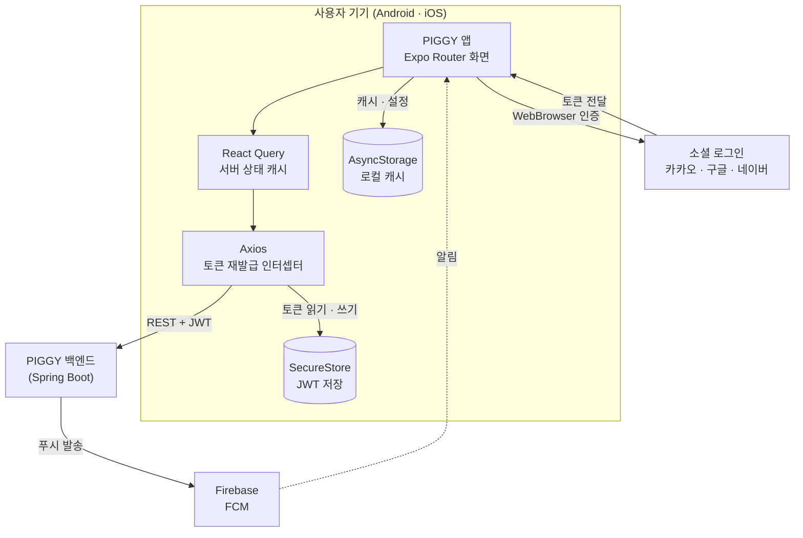
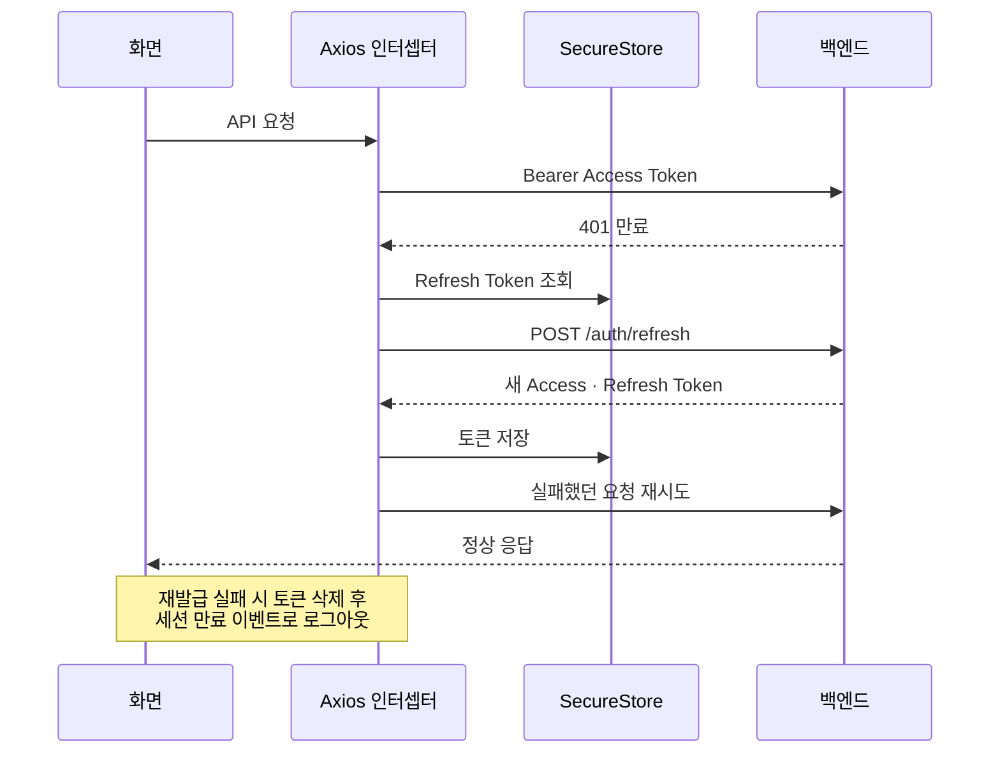
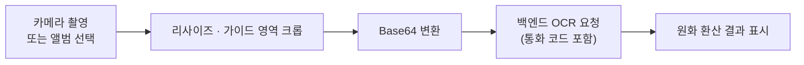

# PIGGY Frontend

> 환율 기반 여행 유틸리티 서비스 **PIGGY** 의 모바일 앱(프론트엔드)입니다. <br>
> 실시간 환율 · 환전 타이밍 · 해외 쇼핑 가격 비교 · 커뮤니티를 하나의 앱에서 제공합니다.

- Backend: https://github.com/piggy-project/piggy-backend <br>
- Frontend: https://github.com/piggy-project/piggy-frontendApp

---

## 1. 프로젝트 개요

### 프로젝트명 & 한 줄 설명

<table>
  <thead>
    <tr><th width="130">항목</th><th>내용</th></tr>
  </thead>
  <tbody>
    <tr><td>프로젝트명</td><td>PIGGY</td></tr>
    <tr><td>한 줄 설명</td><td>실시간 환율, 해외 쇼핑 가격 비교, 커뮤니티를 한 앱에서 제공하는 환율 기반 여행 유틸리티 서비스</td></tr>
    <tr><td>플랫폼</td><td>모바일 앱(Android · iOS) + REST API 서버</td></tr>
  </tbody>
</table>

### 개발 기간 및 인원

<table>
  <thead>
    <tr><th width="130">항목</th><th>내용</th></tr>
  </thead>
  <tbody>
    <tr><td>개발 기간</td><td>2026.02 ~ 2026.06</td></tr>
    <tr><td>인원</td><td>총 2명 (프론트엔드 1명, 백엔드 1명)</td></tr>
  </tbody>
</table>

### 아키텍처 구조도



---

## 2. 사용 기술 스택

| 구분 | 기술 |
| --- | --- |
| Language | TypeScript |
| Framework | React Native 0.86, React 19, Expo SDK 57, Expo Router (파일 기반 라우팅 · typedRoutes), React Compiler |
| 상태 · 데이터 | TanStack React Query 5, Axios, Context API (AuthContext) |
| 로컬 저장소 | expo-secure-store (JWT), AsyncStorage (캐시 · 설정 · 알림 내역) |
| 기기 기능 | expo-camera, expo-image-picker, expo-image-manipulator, expo-notifications (FCM), expo-web-browser · expo-linking |
| UI | react-native-chart-kit, react-native-svg, Reanimated, Gesture Handler, Keyboard Controller, Pretendard 폰트 |
| 인증 연동 | JWT (jwt-decode), 카카오 · 구글 · 네이버 OAuth2 (백엔드 경유) |
| Build / Deploy | EAS Build (development · preview · production), Expo Dev Client, Gradle (Android) |

---

## 3. 핵심 기능 및 담당 역할

### 핵심 기능

<table>
  <thead>
    <tr><th width="170">기능</th><th>설명</th><th width="200">핵심 기술</th></tr>
  </thead>
  <tbody>
    <tr><td>실시간 환율</td><td>주요 9개 통화의 현재가 · 전일 대비 · 당일 고저가 · 시간대별 추이 · 기간별 이력 제공. 최근 90일 환율 대비 현재 환율의 백분위로 환전 적기 안내</td><td>React Query, react-native-chart-kit, AsyncStorage 캐시</td></tr>
    <tr><td>환전 수수료 시뮬레이터</td><td>은행별(국민 · 신한 · 기업 · 토스 · 직접 입력) 수수료율과 우대율을 적용해 최종 수령 외화와 절약 금액 계산</td><td>상태 관리, 실시간 환율 연동</td></tr>
    <tr><td>AI 여행지 추천 · 챗봇</td><td>해시태그별 여행지를 매시간 추천하고, 앱 사용법 · 여행 · 환율 질문에 답변하며 후속 질문 추천</td><td>React Query, AsyncStorage 대화 캐시</td></tr>
    <tr><td>가격 OCR 스캔</td><td>가격표 사진에서 통화 기호와 금액을 인식해 실시간 환율로 원화 환산</td><td>expo-camera, expo-image-manipulator, expo-image-picker</td></tr>
    <tr><td>해외 쇼핑 가격 비교</td><td>네이버(국내)와 통화별 해외 쇼핑 API(Rakuten · eBay · SerpAPI) 가격을 환율 환산해 비교, 검색어 랭킹 기반 인기 상품 제공</td><td>Axios, AsyncStorage 최근 검색어</td></tr>
    <tr><td>환율 알림 (푸시)</td><td>변동률 · 목표가 · 3개월 최저가 · 급등락 알림과 알림 내역 관리</td><td>expo-notifications, FCM, 서버 알림 동기화</td></tr>
    <tr><td>커뮤니티</td><td>게시판(자유 · 환율 · 여행), 댓글, 좋아요, 핫 게시글, 이미지 업로드, 내 활동 조회</td><td>React Query (useQuery · useMutation), FormData 업로드</td></tr>
    <tr><td>회원 · 인증</td><td>이메일 가입(인증 메일), 카카오 · 구글 · 네이버 소셜 로그인, JWT 발급 · 재발급, 탈퇴 후 1개월 뒤 영구 삭제</td><td>expo-web-browser, SecureStore, Axios 인터셉터</td></tr>
  </tbody>
</table>

---

## 4. 화면 구조 및 시스템 아키텍처

### 화면 구조

Expo Router의 파일 기반 라우팅으로 화면을 나누고, 화면별 UI는 `components` 아래 도메인 폴더에서 구성했습니다.

```
piggy
├── app                  # 라우트 (파일 경로 = 화면 경로)
│   ├── (tabs)           # 하단 탭: 홈 · 환율 · 쇼핑 · 커뮤니티 · 마이페이지
│   ├── signup           # 회원가입 단계별 화면 (약관 → 이메일 → 정보 → 닉네임 → 비밀번호)
│   ├── oauth            # 소셜 로그인 추가 정보 입력
│   └── ...              # 로그인, 챗봇, 알림, 환율 상세, 커뮤니티 상세 · 작성 · 수정 등
├── components
│   ├── MainDashBoardPage · ExchangePage · ExchangeDetailPage
│   ├── ShoppingPage · CommunityPage · ChatbotPage
│   ├── MyPage · NotificationPage · LoginPage · Header
│   └── utils            # api, AuthContext, authStore, NotificationHelper, OCRScanner
├── constants            # 통화 정보, 테마, 타이포그래피
└── assets               # 폰트(Pretendard), 이미지, 아이콘
```

### 인증 · 토큰 재발급 흐름

Access Token이 만료되어 요청이 401로 실패하면 Axios 응답 인터셉터가 재발급을 처리합니다.
동시에 여러 요청이 실패해도 재발급은 한 번만 보내고, 나머지 요청은 큐에서 대기했다가 새 토큰으로 재시도합니다.



### 소셜 로그인 흐름

1. 앱이 `WebBrowser`로 백엔드의 `/oauth2/authorization/{provider}` 주소를 엽니다.
2. 백엔드가 소셜 인증을 처리한 뒤 앱 딥링크로 `token`, `refreshToken`을 담아 리다이렉트합니다.
3. 신규 회원이면 추가 정보 입력 화면으로, 기존 회원이면 토큰 저장 후 푸시 토큰을 등록하고 메인으로 이동합니다.
4. 다른 방식으로 가입한 계정이면 서버 메시지를 읽어 어떤 로그인을 써야 하는지 안내합니다.

### 데이터 캐시 전략

| 대상 | 방식 | 비고 |
| --- | --- | --- |
| 커뮤니티 게시글 목록 | React Query `staleTime` 1분 | 카테고리 · 통화 · 검색어를 `queryKey`에 포함해 조건별로 캐시 |
| 핫 게시글 | React Query `refetchInterval` 5분 | 자동 갱신 |
| 내 활동 | React Query `staleTime` 0 | 화면 진입 시마다 최신 데이터 조회 |
| 환율 상세 | AsyncStorage에 통화별 저장 | 저장된 값을 먼저 보여주고 서버 응답으로 갱신 |
| 마지막 선택 통화 | AsyncStorage | OCR 스캔 시 이전 선택 유지 |
| 알림 내역 | AsyncStorage 최대 50건 | 서버 알림을 로그인 시 · 앱 활성화 시 동기화 |
| JWT | SecureStore | Access · Refresh Token 암호화 저장 |

### 푸시 알림 흐름

1. 로그인 후 알림 권한을 요청하고 기기의 FCM 토큰을 가져옵니다. 실패하면 Expo Push Token으로 대체합니다.
2. 토큰을 백엔드에 등록하면 백엔드 스케줄러가 조건 충족 시 푸시를 발송합니다.
3. 포그라운드에서도 알림을 표시하고, 수신한 알림은 로컬에 저장해 알림함에 반영합니다.
4. 로그인 직후와 앱이 다시 활성화될 때 서버의 알림 내역을 동기화합니다.

### OCR 스캔 흐름



- 통화 종류에 따라 가이드 박스 크기를 다르게 보여 가격표 영역만 정확히 잘라서 보냅니다.
- 엔화 · 동화처럼 100단위로 고시되는 통화는 `금액 ÷ 100 × 환율`로 다시 계산해 표시합니다.

### 빌드 · 배포

| 프로필 | 용도 |
| --- | --- |
| `development` | Expo Dev Client로 개발 · 디버깅 (내부 배포) |
| `preview` | 테스트용 내부 배포 빌드 |
| `production` | 배포용 빌드 (버전 자동 증가) |

- 로컬 실행: `npm install` → `npx expo start` (Android는 `npx expo run:android`)
- Android 네이티브 프로젝트(`android/`)와 Firebase 설정(`google-services.json`)을 포함하며, iOS 네이티브 폴더는 필요할 때 생성합니다.
- 서버는 별도 저장소에서 GitHub Actions → Docker Hub → AWS EC2 순서로 배포되며, 앱은 배포된 서버 주소로 REST 요청을 보냅니다.
